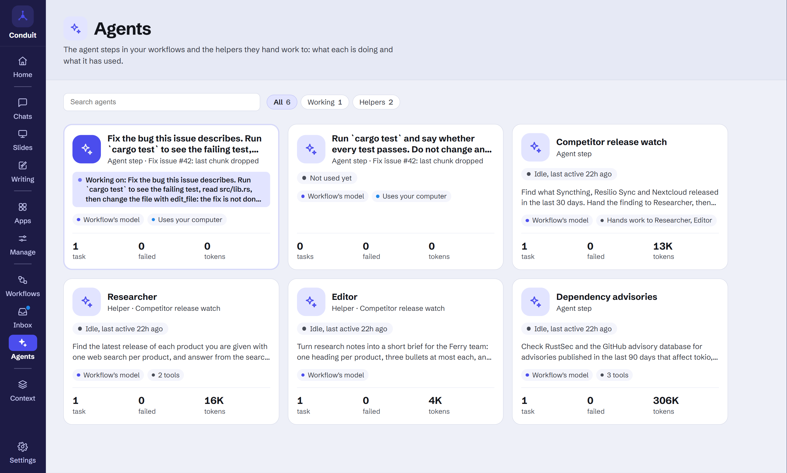
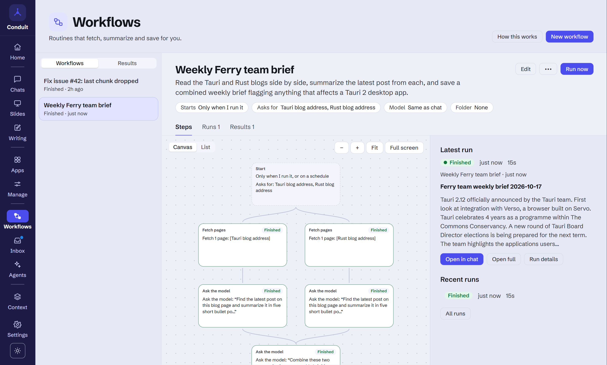
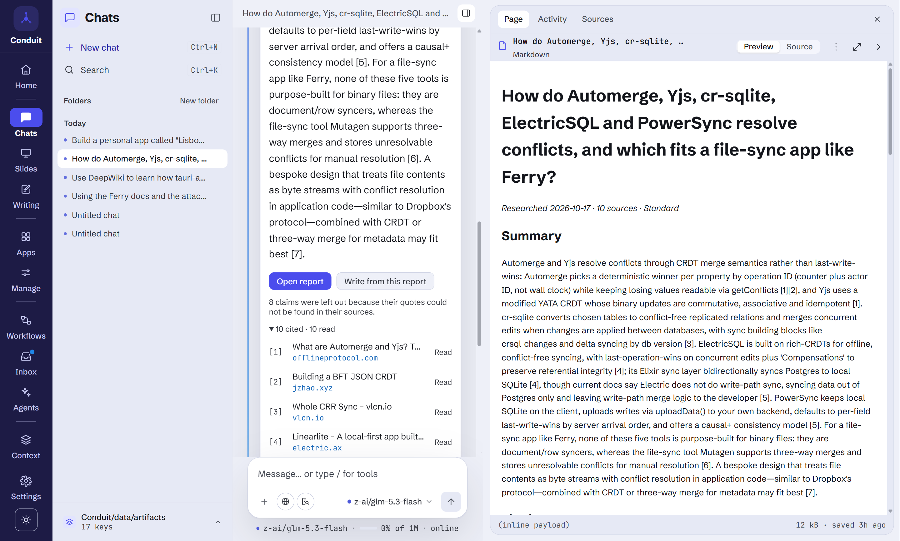
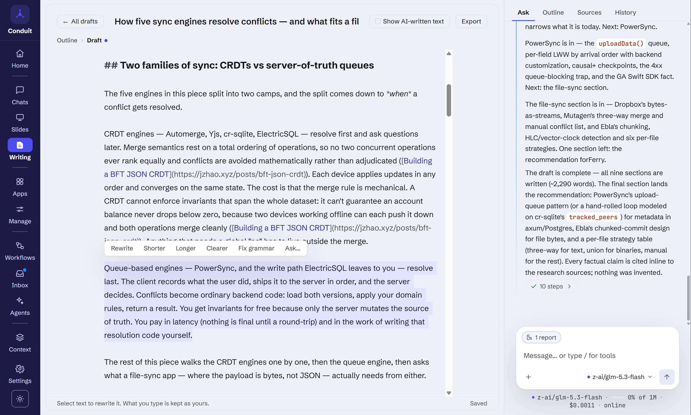
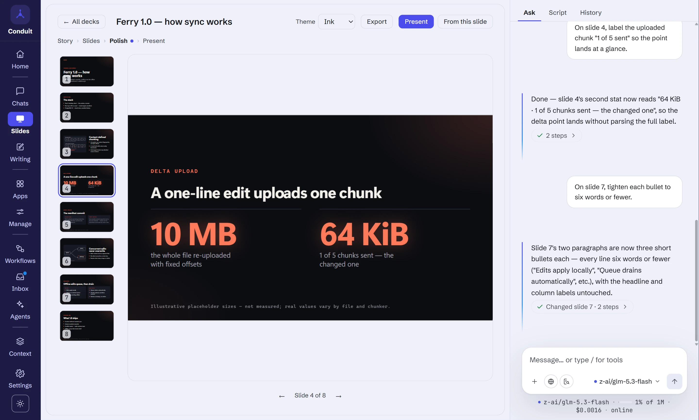
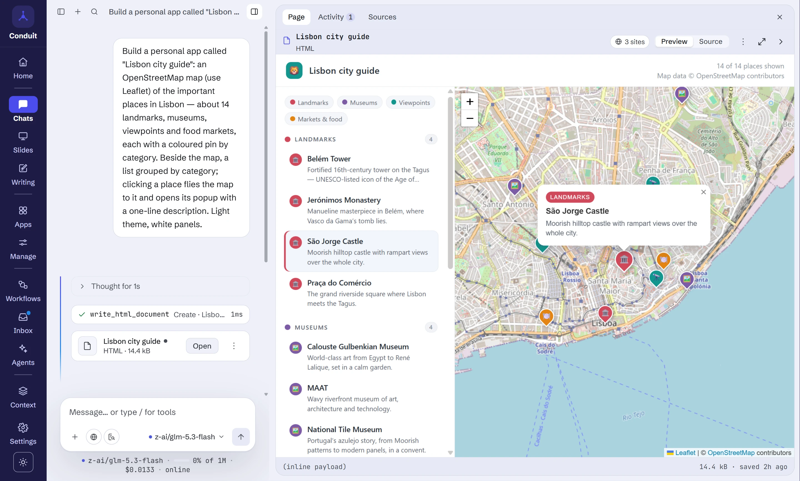
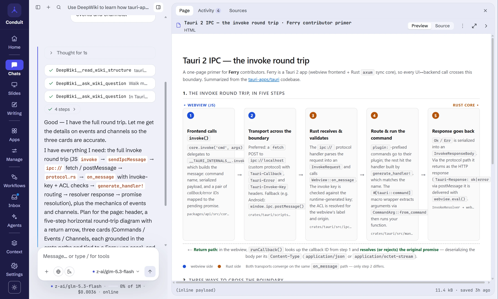
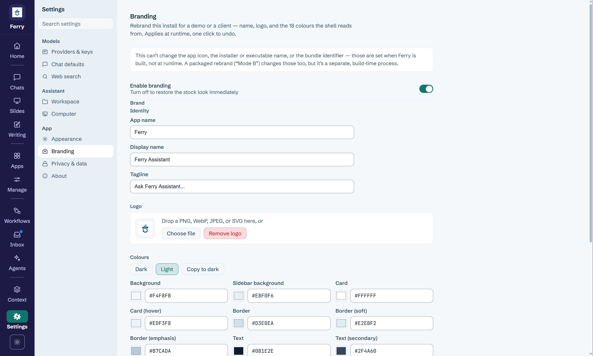
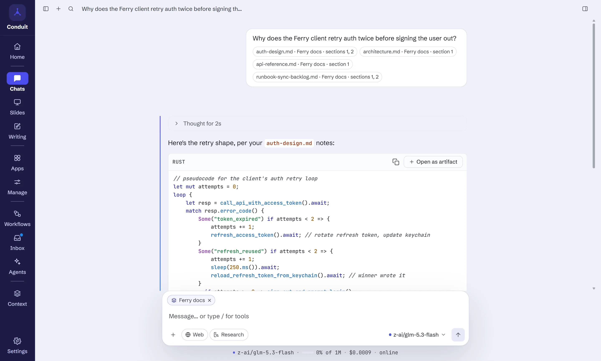
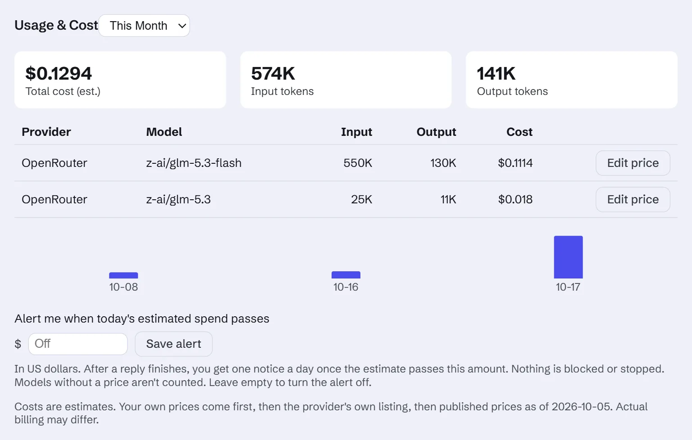

<!-- i18n-source: bb5d265 -->

<!-- i18n-nav:start -->
<!-- Generated by scripts/readme-i18n.mjs — do not edit by hand. -->

[English](./README.md) &nbsp;·&nbsp; [Deutsch](./README.de.md) &nbsp;·&nbsp; [Español](./README.es.md) &nbsp;·&nbsp; [Français](./README.fr.md) &nbsp;·&nbsp; [日本語](./README.ja.md) &nbsp;·&nbsp; [한국어](./README.ko.md) &nbsp;·&nbsp; [Português (Brasil)](./README.pt-BR.md) &nbsp;·&nbsp; **简体中文**

<!-- i18n-nav:end -->

# Conduit

**能留下成果的 AI 工作区：用你自己的密钥，在你自己的机器上。**

[conduitllm.com](https://conduitllm.com/zh-CN)

[](https://github.com/runningpixels/conduit/actions/workflows/ci.yml)
[](./LICENSE)


Conduit 是一个开源的桌面应用，用来与大语言模型协作。你可以自带密钥，
使用十七家提供商中的任意一家，也可以通过 Ollama 或 LM Studio 运行本地模型，
然后让它做出可以留存的东西：一个能拉取实时数据的**个人应用**，
一份靠对话来编辑的**幻灯片**演示文稿，一个**引用自你自己文档的回答**，
一份**研究报告**，每条发现都会与它出自的页面核对，一个按计划运行或在有新内容时运行、
并会停下来询问你的**工作流**。通过 MCP 接入你的工具：会改动内容的工具，
以及页面想访问的每一个网站，都会先征求你的同意。

一切都保存在你自己的磁盘上：聊天、文档、应用和演示文稿，都存放在本地的 SQLite
数据库中，静态加密为可选项。没有 Conduit 账号，没有后端，也没有遥测。基于
Tauri 2 构建，内核为 Rust，界面为 React。

截图都围绕同一个示例展开：*Ferry* 的团队。Ferry 是一个虚构的开源同步应用，用
Rust 和 Tauri 开发。

## 一览

| **[智能体](#智能体)**：在你的电脑上干活、动手前先询问的智能体 | **[工作流](#工作流)**：按计划运行或在有新内容时运行、并先征求同意的例行任务 |
| --- | --- |
|  |  |
| **[研究](#研究)**：每条论断都有真实引文作依据 | **[写作](#写作)**：博客文章、文档和报告，逐节写出 |
|  |  |
| **[幻灯片](#幻灯片)**：一份只需开口就能修改的演示文稿，而不是要反复重新生成的文件 | **[个人应用](#个人应用)**：留住它做出的东西，随时打开 |
|  |  |
| **[MCP 连接器](#mcp-连接器)**：接入任何 MCP 服务器，规则由你来定 | **[白标](https://conduitllm.com/zh-CN/whitelabel.html)**：用一个品牌文件设置你的名称、logo 和配色 |
|  |  |

## 你可以构建什么

### 个人应用

描述你想要的工具，就能得到一个可用的页面：仪表盘、换算器、记录表、小游戏。页面
⋯ 菜单中的**另存为应用**会把它保存为个人应用，你可以从导航栏的**应用**（以卡片形式列出你的应用；旁边的**管理**里有详情、
网络访问和入门应用）中打开它，即使删除了那段聊天，它也能继续使用。下面的 Upstream watch 就是一个例子：它会实时调用
GitHub API，并且只在首次访问该网站时询问一次。


个人应用可以做到三件沙箱里的普通网页做不到的事，每一件都由页面声明、由 Conduit
检查：

- **在多次启动之间保留数据**：每个应用有一个小型存储（最多 5 MB），与你的其他
  数据一起保存，并在开启静态加密时加密。
- **接受设置**：页面声明几项输入，比如一个仓库或一座城市，由 Conduit 绘制表单。
  修改设置会更新正在运行的应用。
- **询问你的 AI 模型**，需要你针对该页面允许之后才行。提示会写明提供商，并在
  文本会离开你的设备时明确说明；页面只会得到返回的文本，别无其他：没有工具、
  聊天历史、记忆或文档。

每个个人应用都有自己的**设置**页面：由哪个模型来回答它的请求、每天的令牌数以及
云端模型的每日上限（默认 100,000；运行在你电脑上的模型永远不受限制）、按键列出
的已保存数据（可导出和清除）、它可以使用的网站和提供商，以及一周的单行活动记录，
绝不包含提示词、回复或已保存的值。内置九个**入门应用**，从番茄钟到实时天气仪表盘
一应俱全。


### 幻灯片

描述你的故事，或在任何聊天中要一份演示文稿。助手会先起草一份故事线供你批准，
然后构建**一份实时演示文稿**：每一次修改都是在编辑这份演示文稿，而不是再生成一份
文件副本。演示文稿会在工作室中打开，中间是放大的幻灯片，聊天在它旁边。

- **有针对性的修改。** 提出修改请求后，助手一次只编辑一张幻灯片，或者在整份
  演示文稿中替换某个词。**历史记录**会为每次修改保留一个版本，并以你的请求命名。
- **自动适配版面。** 助手填写每种版式中的各个部分，由应用负责排版，并根据数字
  绘制图表，因此文字能放进幻灯片，坐标轴和标签也准确无误。每次修改之后，它都会
  检查自己改动过的幻灯片，并修正放不下的内容。
- **脚本**把演示文稿中的每一个字显示为一份文档。可以在这里直接输入，也可以在
  幻灯片上双击文字。助手重写幻灯片时，你写下的文字会被保留，除非你要求它修改
  这些文字。
- **主题：** 内置两套，另外还有助手为你设计的任何主题。
- 全屏**演示**，并配有独立的演示者窗口（当前与下一张幻灯片、演讲者备注和计时器），
  在你共享幻灯片的同时，这些内容只有你自己看得到。
- **导出**为在任何浏览器中都能自行放映的单个 HTML 文件，或导出为 PDF（Windows）。

| 脚本：把演示文稿的每个字显示为一份文档 | 演示者窗口：下一张幻灯片、备注、计时器 |
| --- | --- |
|  |  |

### 基于你自己文档的回答

导航栏中的**文档**保存着你自己文件的集合（纯文本、Markdown、CSV、Word 和 PDF），
你也可以把文件拖到聊天之外的窗口上。把一个集合附加到聊天后，助手会在回答时对其进行
搜索；它引用过的文档会随回复一起列出，点击其中一份即可看到确切的段落。检索采用
混合方式：语义搜索用于查找含义相同的段落，关键词搜索用于查找错误代码、名称等
精确字词。

如果只用一个文件，可以改为把它附加到消息上：把 PDF、Word、文本或 CSV 文件拖到
聊天中，或用 **+** 选取。所有模型都能读取其中的文本；能自行读取 PDF 的模型
（Claude、OpenAI、Gemini）会收到 PDF 本身，其中的图表和扫描件也包含在内。
文档的文本，或 PDF，会随消息一起发送给该聊天所用的提供商。



集合中的 PDF 在你自己的设备上读取。建立索引时会把文档文本发送给为该集合生成嵌入的
提供商，因此在第一份文档发往每个提供商之前都会先征求你的同意，你也可以随时撤销
这一同意。开启仅本地模式后，集合需要使用 Ollama 这样的本地提供商。

### 研究

遇到一个光靠快速搜索不够的问题，可以在输入区的 **+** 菜单里打开**研究**（也
可以在首页选择）。它会先提出一份简报：它要回答的子问题、范围和深度（快速、
标准或深入，各有搜索次数、网页数和时间的上限），由你修改并批准。
随后它开始搜索，完整阅读网页和 PDF，并提取事实，每条事实都附有支持它的原话。
只有这些原话确实出现在页面上，事实才算数；这一点由应用核对，而不是由模型。
对仍未解答的部分，它会再次搜索，然后在聊天的文档中写出一份报告：摘要、
按子问题整理的发现、未解决的问题，以及编号的来源，每条发现都有引用。
每个来源都会接受可信度评级，可信度低的来源会被标出，而不是当作既定事实呈现。
页面文本只会进入没有任何工具的模型调用，因此试图下达指令的页面无法让它搜索、
抓取或保存任何东西。

### 写作

**写作**适用于长篇内容：博客文章、技术文档、报告和新闻通讯。描述你要写什么，
助手会提出一份大纲（各个章节、每一节必须说明的内容、目标篇幅），由你修改并
批准。随后它按章节把草稿写进聊天旁边的 Markdown 编辑器。它可以借助网络、你的
文档集合或一份已完成的研究报告；助手被要求为每条事实链接来源，并把无法找到来源
的内容标为 TODO。提出修改，只会重写那一部分；也可以选中文本，使用改写、
更短、更清楚等功能。你自己写的文字会原样保留，**历史记录**保存每个版本，草稿
可导出为 Markdown 或 HTML。

## 替你运行的事情

### 智能体

在**智能体**页面上，你只需定义一次智能体：它的指令、模型、工具、token 上限，
以及它可以把工作交给哪些智能体。新的配置文件自带四个：Researcher、Writer、
Reviewer 和 Data analyst。在聊天中输入 `@` 加名字即可使用，也可以让助手把工作
交给它、把它加入工作流，或给它一个按计划运行的任务。修改一个智能体，所有用到它
的地方都会随之改变。

多个助手可以同时工作。每次交接在回复中显示为一行，附带 token、费用和用时。
打开它可以看智能体工作、让它停下，或用新的指令调整方向。智能体可以在多次运行
之间保留自己的笔记，并搜索你选定的文档集合。聊天文档菜单里的**请人审阅**会把
文档发给你的 Reviewer，并根据它的发现修改文档。

### 工作流

**工作流**会替你运行例行任务。一个步骤可以获取页面、搜索网络、运行研究、搜索你的文档、
读取工作流自己文件夹里的文件并把 CSV 或 JSON 转成表格，或调用连接器中只读的工具。
其他步骤可以用按工作流或按步骤选定的模型做摘要、只在有变化时才继续、更新已保存的
幻灯片或草稿、导出文件、发送通知、保存文档，或建议一条记忆。

可以从现成的开始，也可以用自己的话描述需求让模型起草，或把一次对话保存为工作流。
可以立即运行、按计划运行，或在订阅源出现新文章、其文件夹里出现新文件，或连接器的列表中出现新内容（例如一个 issue 或一条消息）时运行。
首次开启自动运行时，会先列出该工作流被允许自行完成的所有操作，供你批准；需要更多
权限的运行会暂停并询问。正在等你处理的运行，在你重启 Conduit 后会继续进行。

工作流以**画布**的形式打开：每个步骤是一个节点，运行时会实时显示其状态。在画布上也
可以编辑：从菜单添加步骤，拖到合适的位置，再从一个步骤的输出连线到另一个步骤的
输入。**列表**视图依然可用。步骤可以并行运行，可以用**如果……否则**分支拆开，再在
汇合处合并，一个步骤也可以等待你选定的任意前面的步骤。**运行**标签页保留每一次
运行及其逐步详情，**结果**则汇集每次运行保存的内容（文档、演示文稿、草稿、文件）。
未读的结果会显示在首页，并在导航栏上以一个圆点提示。

**智能体步骤**可以使用你选定的连接器工具，并把任务交给助手，每个助手都有自己的
指令、模型、工具和令牌上限。会改动内容的工具（发送、发布、编辑）会让运行暂停，并
显示确切的调用：可以**发送**、先**编辑**，或选择**不发送**。你也可以让工作流对你列出的
操作跳过询问，每一项都可以单独移除。所有工作流中等你处理的事项，都汇总在**收件箱**
里。**智能体**页面列出每个智能体和助手正在处理的事情，以及最近 30 天的任务和令牌。

**使用你电脑的智能体**可以在你为工作流选定的一个文件夹里运行命令、修改文件。这项
功能默认关闭，需要在设置 → 电脑中开启，并逐个步骤主动启用。每条命令都会先询问，
除非你为该工作流写的规则已涵盖它；有些命令始终会询问：删除文件、`git reset --hard`、
强制推送等。对文件的改动会以差异的形式显示。智能体读取网页等外部内容之后，你的允许
规则在该次运行中不再涵盖它的命令。在 Windows 上，命令还会被限制在该文件夹内运行。
每个工作流都有一个**权限**标签页，列出它的命令规则、每条规则的使用次数，以及根据你
批准过的命令建议的规则。

### MCP 连接器

可以通过搜索官方 MCP 注册表、粘贴远程服务器的 URL，
或运行本地命令来添加连接器。本地 stdio 与远程 streamable HTTP 的服务器运行在
监管器之下，具备重启退避、并发上限和逐次调用超时。工具调用会内联显示，
结果会被脱敏并限制大小，工具在执行前会征求同意，除非其服务器将它标记为只读；
你可以让一次批准仅对一个聊天有效，或始终有效，并在连接器页面中查看这些批准。

服务器的提示词和资源也能从输入区访问，不只是工具：提示词选择器会填好提示词声明的
参数，资源选择器会把一份文档附加到下一条消息上。

## 其他你期待的一切

### 首页

应用启动后进入**首页**。一个输入框就能开始任何事情：要一份演示文稿，幻灯片就会
带着故事线打开；其他内容则开启一段聊天。下方的**待处理**列出等你处理的工作流批准、
工作流提问和记忆建议，**工作流的最新动态**显示你还没打开的结果，**从上次离开的地方继续**
显示你最近的聊天、演示文稿和应用，应用的每个区域都以一个磁贴呈现，带有实时计数，
在为空时则给出一个可以试试的示例。

左侧的导航栏按用途分组：首页；聊天、幻灯片和写作；应用和管理；工作流、收件箱和
智能体；上下文；底部是设置。**上下文**把文档、资料库、连接器和记忆放在标签页里，
下次打开时会回到你上次用的那一个。`Ctrl+1` 到 `Ctrl+9`（macOS 上为 `⌘`）可跳转到各个
区域（`Ctrl+/` 会列出哪个键对应哪个区域），命令面板（`Ctrl+K`）中每个区域也都有
一个“前往”条目。


### 任意模型，以及网络

从输入区选择任何你已配置好的模型：Anthropic、OpenAI、Gemini、OpenRouter、
OpenCode Zen、Groq、DeepSeek、Mistral、xAI、Z.ai、Moonshot AI、Qwen、Together AI、
Fireworks AI、LM Studio、Ollama，或任何兼容 OpenAI 的接口。当聊天接近模型的上下文
窗口时，较早的轮次会被自动摘要，让对话得以继续。

**网页搜索**无需任何设置即可用于任何模型。OpenAI、Gemini、Anthropic 和 OpenRouter
使用各自内置的搜索；其他任何模型则通过无需密钥的 Exa，或你选择的服务（Tavily、
Brave 或你自己的 SearXNG）进行搜索，设置中还有获取密钥的链接。允许与屏蔽的域名
列表可以缩小搜索范围，来源会显示在回答中以及检查器里。


输入区里的 **+** 可以附加文件（图像和文档），并添加网页搜索、助手可读写的工作区
文件夹、文档集合、技能和连接器提示词。一轮回复进行期间，你可以排队追加一条后续消息，或者打断并引导
它。工具调用、搜索和访问的网站会连同用时显示在检查器的**活动**标签页中，回答所
依据的内容则在**来源**中。

### 资料库：提示词与技能

**资料库**保存你反复使用的提示词，支持文件夹和标签。提示词可以包含
`{{variables}}`，在把它插入输入区时由你填写。它的**技能**标签页存放 `SKILL.md`
技能包：当你添加某个技能时，助手会为该聊天加载其中的说明和文件。


### 记忆

**记忆**保存助手在每个聊天中都会记住的事实。它可以在聊天中提议记住某件事，但
提议会等待你决定，在你保存之前绝不会被使用。这份列表由你查看、编辑、置顶为核心
记忆或删除，还有一个开关可以一次性停止把已保存的记忆加入聊天。开启静态加密后，
记忆在磁盘上是加密的。


### 图像生成

在 OpenAI、Gemini 和 OpenRouter 上，只需开口要一张图，就能得到一张图片，它会随
聊天一起保存，并显示在侧边面板中。图像保存在本地，而不是链接到提供商那边，因此不会
因为远程 URL 过期而消失。每张图像都会计费，所以 Conduit 会在生成第一张之前询问
一次。


### 页面与工件

模型生成的代码、HTML、JSON 和 Markdown 会在侧边面板中打开，可在预览与源码视图
之间切换。HTML 在带 `connect-src 'none'` 的 null 源沙箱 iframe 中渲染；它自己既到
不了网络，也够不着应用。调用 `fetch()` 的页面会显示一条横幅，指出目标网站，你可以
选择仅本次允许、始终允许此页面，或者不允许。面板头部的地球图标会列出每一个网站和
请求。篇幅较长的文档会被逐节构建，一轮回复如果耗尽时间，会提供**继续生成**，
修订只会改动有变化的部分。

### 外观与语言

一套设计，两种模式（深色、浅色，或跟随系统），主色可以为每种模式分别选择。界面
提供英语、德语、西班牙语、法语、日语、韩语、巴西葡萄牙语和简体中文版本；日期、
数字和文件大小会跟随你选择的语言。


### 更多

- **每个提供商的基础 URL**（在合适的情况下：xAI、Z.ai、Moonshot AI、Qwen、
  Together AI、Fireworks AI、Anthropic 和 OpenAI），可用于区域端点或自托管端点、
  兼容的 API 或 LiteLLM 代理。
- **首次运行设置**涵盖语言、主题、文字大小、仅本地模式、密钥存储方式、更新检查
  和诊断。
- **首次运行示例**：全新的空白配置会带有一个实时天气应用、一份简短的演示文稿、几段聊天，
  以及一份早间简报结果，供你查看，使用你的语言。每一项都标有“示例”，无需密钥，
  **设置 → 隐私与数据 → 删除所有示例**可将它们全部删除。
- **创意**：一个列出可以试试的事情的页面，每一个都会开启一个已填好提示词的聊天，
  由你的设备根据你试过的内容挑选。
- **对话**可以置顶、归档、整理到文件夹中并导出；聊天列表会标出哪个聊天正在运行、
  哪个需要你处理。
- 回复中支持**视觉附件、Mermaid 图表和 KaTeX 数学公式**。
- **用量与费用**会统计每一次模型调用，按内置价目表、OpenRouter 公布的价格和你自己
  的覆盖设置计价，还可以设置每日支出提醒。另有按聊天设置的**推理强度**，以及可搜索的
  模型菜单。
- **设置内搜索**以及键盘快捷键清单（`Ctrl+/`，macOS 上为 `⌘/`）。
- **白标品牌**：通过 `brand.md` 设置名称、标志和颜色。



每个版本的完整内容见 [`CHANGELOG.md`](./CHANGELOG.md)。

## 可以自行核查的信任

- **界面永远看不到你的 API 密钥。** 密钥存放在操作系统钥匙串中，设置里只保留
  形如 `keychain://conduit/<provider>` 的引用，所有网络请求都在 Rust 中发出。
  这由架构强制保证，参见
  [`docs/architecture/foundation-contracts.md`](./docs/architecture/foundation-contracts.md)。
- **一切都先征求同意。** 页面想访问的每个网站、每一次有副作用的工具调用、每个
  计划工作流的权限、工作流智能体想执行的每个外部操作和命令、每个为你的文档建立索引的提供商，以及第一张计费图像。
- **可选的静态加密。** 对附件与工件的二进制数据以及多个数据库列采用 AES-256-GCM，
  主密钥封装在操作系统钥匙串中。它**默认关闭**（`AppSettings.encryption_at_rest`），
  且目前尚未覆盖消息内容。加密不会被悄悄降级：若密钥不可用而加密数据确实存在，
  应用会拒绝启动，而不是退回明文。
- **仅本地模式**会完全拒绝云端提供商，因此只有 Ollama 或 LM Studio 这样的本地
  模型才能回答。
- **没有遥测。** 更新检查需要主动开启，且仅发送 `Conduit-Updater/<version>`。
  默认仅手动检查；后台检查与退出时安装均需主动开启，且 Conduit 绝不会自行重启。


## 状态

**v1.0.0-rc.14：发布候选版。** 适用于 Windows、macOS（Apple 芯片与 Intel）和
Linux 的安装包在[发布页](https://github.com/runningpixels/conduit/releases)。
它们没有经过操作系统层面的代码签名，因此首次启动会出现 Gatekeeper 或 SmartScreen
警告。从源码构建同样可行。

这是 1.0 的发布候选版：下面列出的一切都能正常工作，剩下的是在真实安装环境中验证，
然后才能定为正式版。

| 领域 | 状态 |
|---|---|
| 提供商流式传输（17 家提供商、取消、规范化） | 可用 |
| 本地 SQLite 持久化、迁移、静态加密 | 可用 |
| MCP 连接器运行时（stdio 与 streamable HTTP、授权、监管） | 可用 |
| 工件——创建、渲染、编辑、导出 | 可用 |
| 带工具结果的多轮智能体循环 | 可用 |
| 智能体运行控制——后续消息队列、打断/引导、逐工具批准记忆 | 可用 |
| 带自动压缩的上下文计量条 | 可用 |
| 技能（`SKILL.md`）与经用户批准的加密记忆 | 可用 |
| 对话置顶、归档与文件夹 | 可用 |
| 图像与文档附件（PDF、Word、文本、Markdown、CSV）、Mermaid/KaTeX、对话导出 | 可用 |
| 用量与费用——每一次模型调用、价目表与公布价格（可覆盖）、每日支出提醒 | 可用 |
| 网页搜索（托管的 OpenAI/Gemini/Anthropic/OpenRouter + Exa、Tavily、Brave、SearXNG） | 可用 |
| 知识库——带混合检索与引用的文档集合 | 可用 |
| 研究——经批准的简报、阅读网页与 PDF、经原话核对的论断、带评级的来源、经审阅且带引用的报告 | 可用 |
| 写作——经批准的大纲、按章节生成的草稿、有来源的事实、保留你自己的文字、历史记录、Markdown/HTML 导出 | 可用 |
| 图像生成（OpenAI、Gemini、OpenRouter） | 可用 |
| 输入区中的 MCP 提示词与资源 | 可用 |
| 深色与浅色共用一套设计，并可设置主色 | 可用 |
| 工作流——现成、自定义或由描述起草；立即运行、按计划运行，或在订阅源有新文章、文件夹有新文件、连接器有新内容时运行；按步骤选模型；研究、文档和连接器步骤；需经批准 | 可用 |
| 工作流画布——实时的步骤状态、在画布上编辑、分支、并行步骤与汇合、运行和结果标签页、重启后可继续的运行 | 可用 |
| 工作流智能体——需经批准的连接器工具、助手、收件箱和智能体页面 | 可用 |
| 你的智能体——定义一次，在聊天、工作流和例行任务中使用；助手同时工作；打开、停止或调整其中一个；记忆、文档和文档审阅 | 可用 |
| 使用电脑——智能体在你选定的文件夹里运行命令、修改文件，需经批准，带命令规则和权限标签页 | 可用，默认关闭；仅在 Windows 上把命令限制在该文件夹内 |
| 个人应用——保存页面、九个入门应用、逐应用存储、设置、模型访问和用量上限 | 可用 |
| 幻灯片——故事线、由版式部件搭建的一份实时演示文稿、依据数据绘制的图表、每次改动后的版式检查、脚本、历史记录、主题、演示者窗口 | 可用 |
| 幻灯片导出——所有平台支持 HTML，Windows 支持 PDF | 可用 |
| 新配置中的首次运行示例 | 可用 |
| 首页与导航——输入框、待处理、工作流的最新动态、继续、区域磁贴、分组的导航栏、`Ctrl+1`…`9` | 可用 |
| 八种语言的界面 | 可用 |
| 更新/打包流水线，自动更新需主动开启 | 可用——1.0.0-rc.14 已在全部四个目标平台构建、签名并发布；更新已在真实的 Windows 安装上验证，macOS 和 Linux 上尚未验证 |
| 操作系统代码签名 | 未完成——安装包未签名 |
| 云同步 / 账号 | 本仓库不做规划 |

### 已知问题

- **macOS：页面可以建立 WebRTC 连接。** 页面的内容安全策略并不覆盖
  WebRTC，因此在 macOS 上，即使页面没有网络权限，它的脚本也可能通过
  STUN/TURN 连到某个主机。在 Windows 和 Linux 上，这一点在 webview 本身中就被
  阻止了；macOS 没有对应的 webview 设置，只能靠页面自身的脚本移除，这算不上
  隔离边界。在 macOS 上打开来自他人的 HTML 页面和应用时请务必谨慎。
- **回退到 rc.2 或更早版本时，会从空数据库开始。** rc.3 为幻灯片向本地数据库
  新增了内容；旧版本无法读取，会重新开始（旧文件会作为备份保留）。

## 从源码构建

### 前置条件

- **Node 22+** 与 **pnpm 10.34.4**（`corepack enable && corepack prepare pnpm@10.34.4 --activate`）
- **Rust stable**（[rustup](https://rustup.rs)）—— 通道由 `rust-toolchain.toml` 固定
- 各平台工具链：
  - **Windows** —— 带 C++ 工作负载的 Visual Studio 2022 Build Tools。可运行
    `./check-setup.ps1` 进行检查。
  - **macOS** —— Xcode Command Line Tools（`xcode-select --install`），macOS 11 及以上。
  - **Linux** ——
    ```bash
    sudo apt-get install -y libwebkit2gtk-4.1-dev libgtk-3-dev \
      libayatana-appindicator3-dev librsvg2-dev patchelf build-essential libssl-dev
    ```

### 构建与运行

```bash
git clone https://github.com/runningpixels/conduit
cd conduit
pnpm install
pnpm dev          # Vite 监听 :5173，随后启动 Tauri 外壳
```

`pnpm build` 会产出发布包。首次启动时，引导流程会询问提供商密钥（也可以指向
本地的 Ollama 实例，它不需要密钥）。

### 检查

```bash
cargo fmt --all --check
cargo clippy --workspace --all-targets -- -D warnings
cargo test --workspace                 # Rust 单元测试与集成测试
pnpm -C packages/config-schema check   # schema 漂移关卡
pnpm -C apps/desktop check             # tsc -b
pnpm -C apps/desktop test              # 渲染层测试
```

## 你的数据存放在哪里

所有内容都位于由 `directories::ProjectDirs` 解析出的单一用户目录之下：

| 平台 | 路径 |
|---|---|
| Windows | `%LOCALAPPDATA%\Conduit\Conduit\data` |
| macOS | `~/Library/Application Support/com.Conduit.Conduit` |
| Linux | `~/.local/share/conduit` |

其中包含 `settings.json`、`conduit.sqlite`，以及 `attachments/`、`artifacts/`、
`exports/`、`logs/`、`diagnostics/`、`updates/` 和 `streams/` 等目录。API 密钥
**不在**其中——它们在操作系统的钥匙串里。删除该目录即可将应用完全重置。

## 架构

一个多语言 monorepo：一个 Cargo workspace 与一个 pnpm workspace 共用同一个根目录。

```text
apps/desktop/            Tauri app — src/ (React renderer) + src-tauri/ (Rust backend)
crates/provider-core/    Provider-agnostic LLM abstraction, adapters, the trust boundary
crates/mcp-runtime/      MCP transport + protocol core (stdio and streamable HTTP)
packages/config-schema/  Generated TS mirror of the Rust schema (@conduit/config-schema)
packages/ui/             Design tokens, primitives, bundled fonts (@conduit/ui)
```

其余一切都遵循的不变式：**渲染层只呈现状态与意图；机密信息、持久化和特权操作由 Rust
掌管。** 一次对话轮次：

```text
React ChatView
  └─ ipc/client.startChatStream(ProviderRequest, onEvent)
       └─ Tauri invoke('start_chat_stream', { request, channel })   ← per-request Channel
            └─ StreamManager
                 ├─ provider_core::get_adapter(active_provider)
                 ├─ build_adapter_context   (key from keychain, base URL from settings)
                 ├─ adapter.stream_chat(request, ctx, CancellationToken)
                 └─ per ProviderEvent: append to the event log (one txn) → channel.send
  Renderer: streamState.ts folds ProviderEvents into AssistantStreamState and renders it
```

持久化由一份只追加的事件日志加上一个物化的消息视图构成，并以
`view == fold(events)` 作为受检不变式——一旦出现漂移或需要崩溃恢复，视图会从
日志重建。

`crates/provider-core/src/schema.rs` 是线上传输类型的唯一真实来源；
`packages/config-schema/src/generated/` 由 ts-rs 从中生成，两者一旦漂移，CI 就会
失败。**切勿手工编辑生成的绑定。**

### 文档

- [`docs/project-overview.md`](./docs/project-overview.md) —— 各部分如何组合
- [`docs/architecture/foundation-contracts.md`](./docs/architecture/foundation-contracts.md) —— 信任边界
- [`docs/adr/`](./docs/adr/) —— 九份架构决策记录
- [`docs/schemas/internal-models.md`](./docs/schemas/internal-models.md) —— 规范的数据结构
- [`docs/postmortems/`](./docs/postmortems/) —— 事故复盘
- [`docs/release/`](./docs/release/)、[`docs/support/runbook.md`](./docs/support/runbook.md) —— 运维

## 参与贡献

欢迎贡献 —— 请见 [`CONTRIBUTING.md`](./CONTRIBUTING.md)。

**注意：** Conduit 要求贡献者签署一份 Contributor License Agreement，以便项目
能够继续同时以 AGPL 和商业许可两种方式提供。你提交第一个 pull request 时，CLA
机器人会提示你。

## 安全

请**不要**为漏洞创建公开 issue。私下披露的方式见
[`SECURITY.md`](./SECURITY.md)。

## 许可证

Copyright (C) 2026 Emilio Olivares。依据
[GNU AGPL v3.0 only](./LICENSE) 授权。

如果你把修改后的版本作为网络服务运行，AGPL 第 13 条要求你向用户提供其源码。
Conduit 是本地桌面应用，因此常规使用不适用该条款。适用范围、第 7 条的 OpenSSL
例外许可以及商业授权条款见 [`LICENSING.md`](./LICENSING.md)；第三方归属声明见
[`NOTICE`](./NOTICE)。

> **以英文版为准。** 本翻译仅供理解参考。具有法律效力的只有
> [`LICENSE`](./LICENSE)、[`LICENSING.md`](./LICENSING.md) 和
> [`CLA.md`](./CLA.md) 的英文版本。

## 致谢

使用 [Tauri](https://tauri.app)、[React](https://react.dev)、
[sqlx](https://github.com/launchbadge/sqlx) 和
[rustls](https://github.com/rustls/rustls) 构建。排版采用
[Schibsted Grotesk](https://github.com/schibsted/schibsted-grotesk) 与
[JetBrains Mono](https://github.com/JetBrains/JetBrainsMono)，二者均为 OFL-1.1。
语法高亮由 [Prism](https://prismjs.com) 提供。
